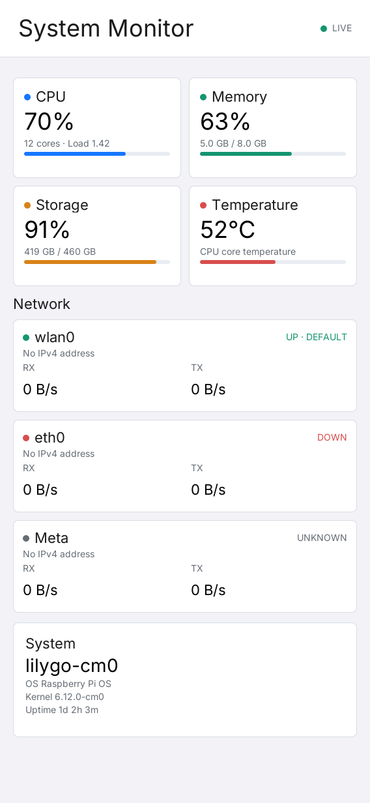
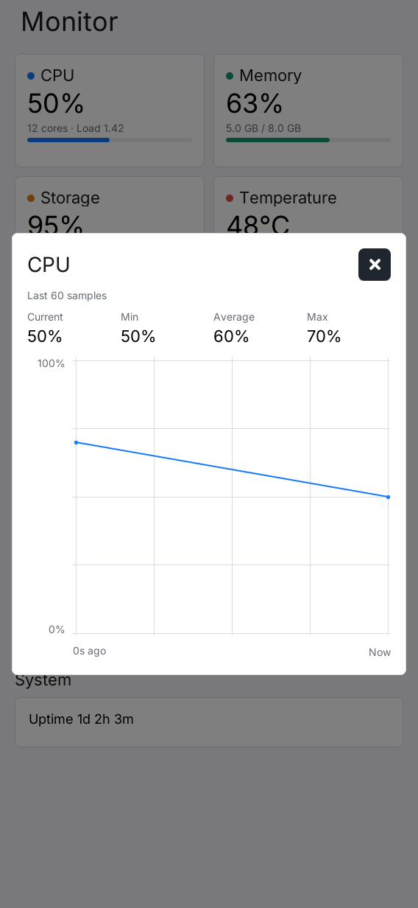

# LILYGO UI System Monitor

**English** | [简体中文](README.zh-CN.md)

A lightweight system dashboard for LILYGO UI devices. The application refreshes every second, providing a quick overview of CPU, memory, storage, temperature, network, and basic system information.



## Features

- CPU usage, online core count, and 1-minute load average
- Memory usage percentage, used memory, and total memory
- Root filesystem usage percentage, used space, and total space
- CPU temperature and high-temperature status indicators
- A dynamically generated card for each network interface, excluding loopback and Docker-related interfaces, showing link status, IPv4 address, and live upload and download rates
- Hostname, operating system, kernel version, and uptime
- Tap a measurement card to view a trend chart of the latest 60 samples and current, minimum, average, and maximum values; network cards show both RX and TX curves
- Responsive layouts for `568x1232` portrait and `1232x568` landscape displays

## Measurement Statistics

Tap a CPU, memory, storage, temperature, network, or uptime card to open its statistics dialog. Data updates every second, and history accumulates from the current application launch, retaining up to 60 samples. Invalid readings appear as `--` and are excluded from minimum, average, and maximum calculations; charts preserve gaps for missing samples. Tap the close button in the upper-right corner or outside the dialog to return to the dashboard.



## Data Sources

System information is read directly from standard Linux interfaces, with no background service required:

| Information | Data source |
| --- | --- |
| CPU, memory, load, and uptime | `/proc/stat`, `/proc/meminfo`, `/proc/loadavg`, `/proc/uptime` |
| Network interfaces and traffic | `/proc/net/route`, `/proc/net/dev`, `/sys/class/net/*/operstate`, `getifaddrs()` |
| Temperature | `/sys/class/thermal/thermal_zone*/temp` |
| Storage | `statvfs("/")` |
| System identity | `/etc/os-release`, `/proc/sys/kernel/*` |

## Development Environment

The build requires Git, CMake 3.21 or later (including CTest and CPack), a C/C++ compiler with C++17 support, Make, patch, pkg-config, and Python 3.11 or later. The host simulator additionally needs SDL2 and FreeType development libraries. LPM is required even when using CMake directly: configuration runs `lpm metadata --format cmake` to read `lpm.toml`.

### 1. Install Host Dependencies

**Debian 12 / Ubuntu 24.04 or later:**

```sh
sudo apt-get update
sudo apt-get install -y git build-essential cmake pkg-config patch \
  libsdl2-dev libfreetype6-dev python3 python3-venv python3-pip
```

On older distributions, upgrade CMake and Python to the minimum versions above before continuing.

**macOS:** Install the Xcode Command Line Tools if needed, then install dependencies using [Homebrew](https://brew.sh/). Complete the Homebrew shell setup so that `brew` and its installed tools are on `PATH`.

```sh
xcode-select --install
brew install git cmake pkg-config sdl2 freetype python
```

The macOS simulator supports UI development and tests. Metrics that depend on Linux `/proc` and `/sys` are unavailable there and display `--`; use Linux or the device to inspect those live metrics.

### 2. Clone the Repository and Initialize AppKit

```sh
git clone --recurse-submodules https://github.com/LILYGO-UI/lilygo-ui-monitor.git
cd lilygo-ui-monitor
```

For an existing checkout, run the following from the repository root:

```sh
git submodule update --init --recursive
```

The presets use the pinned `third_party/cm0-appkit` submodule. It includes the LVGL 9.5 source archive and applies the required patches during configuration, so no separate LVGL installation is needed. Run all remaining commands from the repository root.

### 3. Install LPM

Install [LPM](https://github.com/LILYGO-UI/lpm) in a project virtual environment using Python 3.11 or later:

```sh
python3 -m venv .venv
. .venv/bin/activate
python -m pip install "git+https://github.com/LILYGO-UI/lpm.git"
lpm --version
```

Reactivate the environment with `. .venv/bin/activate` in each new terminal before running `lpm`. CMake also searches `.venv/bin` automatically; for an installation elsewhere, add it to `PATH` or configure with `-DLPM_EXECUTABLE=/absolute/path/to/lpm`.

Check the host environment before building:

```sh
cmake --version
python --version
pkg-config --modversion sdl2 freetype2
lpm metadata --format cmake
```

### 4. Install the Device Cross Compiler

Skip this step when only building the host simulator. Device builds target AArch64 Linux and require a separate cross compiler on the development machine.

**Debian / Ubuntu:**

```sh
sudo apt-get install -y gcc-aarch64-linux-gnu g++-aarch64-linux-gnu
```

**Apple Silicon macOS:**

```sh
brew install aarch64-unknown-linux-gnu
```

The BSP toolchain expects the following executable names on `PATH` (the Homebrew package provides them too):

```sh
aarch64-linux-gnu-gcc --version
aarch64-linux-gnu-g++ --version
```

The first `lpm pack` (or `cmake --preset cm0-cross`) downloads the pinned [CM0 BSP 0.1.0](https://github.com/LILYGO-UI/CM0BspBuilder/releases/download/0.1.0/cm0_sdk.tar.gz), verifies its SHA-256 checksum, and extracts the target sysroot to `.cache/cm0-bsp/0.1.0/sysroot`. This requires access to GitHub; subsequent builds reuse the cache. The sysroot provides target headers and libraries, including DRM and FreeType, but does not install the host cross compiler. No local CM0BspBuilder checkout or manual SDK build is required.

## Build and Test

After completing the environment setup, use LPM from the repository root. It reads the build presets and package output directory from `lpm.toml`.

Configure and build the host simulator, then run the tests:

```sh
lpm test
```

Build and start the simulator in the foreground:

```sh
lpm start --foreground
```

To start an existing build without rebuilding, use `lpm start --no-build --foreground`.

Cross-compile for the device and create a Debian package in `dist/`:

```sh
lpm pack
```

<details>
<summary>Underlying CMake commands</summary>

LPM wraps the following build steps. You can also run them directly when debugging the build configuration; LPM is still required to read project metadata.

Host build and tests:

```sh
cmake --preset host-simulator
cmake --build --preset host-simulator --parallel
ctest --preset host-simulator
```

Device build and packaging:

```sh
cmake --preset cm0-cross
cmake --build --preset cm0-cross --parallel
cpack --config build/cm0-cross/CPackConfig.cmake -B dist
```

</details>

## Code Structure

- `src/pages/monitor/monitor_model.*`: Plain data state and delta calculations for CPU and network metrics
- `src/pages/monitor/system_metrics_source.*`: Data collection through Linux `/proc`, `/sys`, and system calls
- `src/pages/monitor/monitor_view_model.*`: Display text, unit formatting, and LVGL Subject updates
- `src/pages/monitor/monitor_view.*`: Responsive LVGL page and refresh timer
- `tests/`: Model, collector, ViewModel, and portrait/landscape rendering tests
