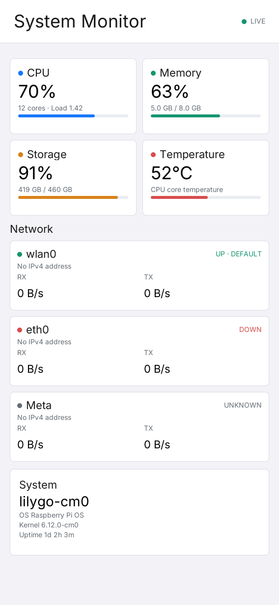
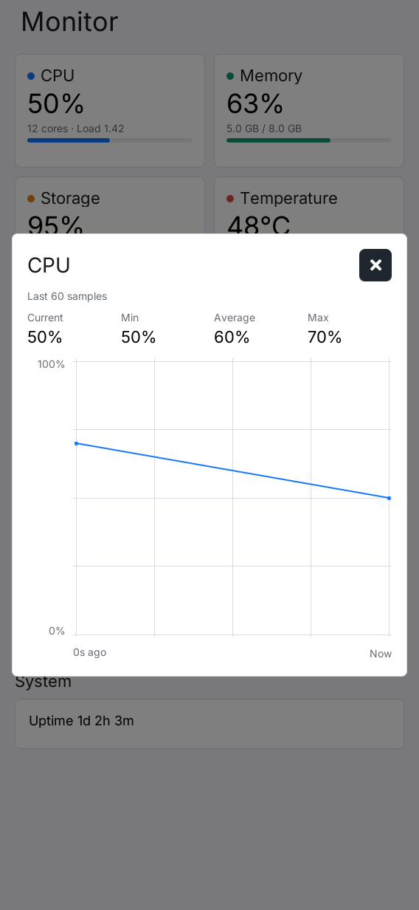

# LILYGO UI 系统监视器

[English](README.md) | **简体中文**

一个面向 LILYGO UI 设备的轻量系统状态面板。应用每秒刷新一次，打开后即可快速查看 CPU、内存、存储、温度、网络和基础系统信息。



## 功能

- CPU 使用率、在线核心数与 1 分钟平均负载
- 内存使用率、已用容量与总容量
- 根文件系统使用率、已用容量与总容量
- CPU 温度与高温状态提示
- 除回环和 Docker 相关接口外的全部网卡，每张网卡动态生成独立卡片，显示链路状态、IPv4 地址及实时上下行速率
- 主机名、操作系统、内核版本与运行时间
- 点击测量卡片查看最近 60 次采样的趋势图和当前、最低、平均、最高值；网卡同时显示 RX、TX 两条曲线
- `568x1232` 竖屏和 `1232x568` 横屏响应式布局

## 测量统计

点击 CPU、内存、存储、温度、网卡或运行时间卡片即可打开对应统计弹窗。数据每秒更新，历史从本次应用启动后开始积累，最多保留 60 次采样。无效读数显示为 `--`，不计入最低、平均和最高值；图表保留缺失采样的断点。点击右上角关闭按钮或弹窗外区域返回面板。



## 数据来源

系统信息直接读取 Linux 的标准接口，不需要后台服务：

| 信息 | 数据源 |
| --- | --- |
| CPU、内存、负载、运行时间 | `/proc/stat`、`/proc/meminfo`、`/proc/loadavg`、`/proc/uptime` |
| 网络接口与流量 | `/proc/net/route`、`/proc/net/dev`、`/sys/class/net/*/operstate`、`getifaddrs()` |
| 温度 | `/sys/class/thermal/thermal_zone*/temp` |
| 存储 | `statvfs("/")` |
| 系统身份 | `/etc/os-release`、`/proc/sys/kernel/*` |

## 编译环境搭建

构建需要 Git、CMake 3.21 或更新版本（包含 CTest 和 CPack）、支持 C++17 的 C/C++ 编译器、Make、patch、pkg-config，以及 Python 3.11 或更新版本。主机模拟器还需要 SDL2 和 FreeType 开发库。即使直接使用 CMake，也必须安装 LPM：配置阶段会执行 `lpm metadata --format cmake` 读取 `lpm.toml`。

### 1. 安装主机依赖

**Debian 12 / Ubuntu 24.04 或更新版本：**

```sh
sudo apt-get update
sudo apt-get install -y git build-essential cmake pkg-config patch \
  libsdl2-dev libfreetype6-dev python3 python3-venv python3-pip
```

使用更早的发行版时，请先将 CMake 和 Python 升级至上述最低版本。

**macOS：** 如果尚未安装 Xcode Command Line Tools，先安装命令行工具，再通过 [Homebrew](https://brew.sh/) 安装依赖。请完成 Homebrew 的 shell 环境配置，确保 `brew` 及其安装的工具在 `PATH` 中。

```sh
xcode-select --install
brew install git cmake pkg-config sdl2 freetype python
```

macOS 模拟器可用于 UI 开发和测试。依赖 Linux `/proc` 和 `/sys` 的指标在 macOS 上不可用，会显示 `--`；查看这些实时指标需要在 Linux 或设备上运行。

### 2. 克隆仓库并初始化 AppKit

```sh
git clone --recurse-submodules https://github.com/LILYGO-UI/lilygo-ui-monitor.git
cd lilygo-ui-monitor
```

如果已经克隆仓库，在仓库根目录执行：

```sh
git submodule update --init --recursive
```

构建预设使用锁定版本的 `third_party/cm0-appkit` 子模块。子模块已包含 LVGL 9.5 源码归档，并在配置时应用所需补丁，无需单独安装 LVGL。后续命令均在仓库根目录执行。

### 3. 安装 LPM

使用 Python 3.11 或更新版本，在项目虚拟环境中安装 [LPM](https://github.com/LILYGO-UI/lpm)：

```sh
python3 -m venv .venv
. .venv/bin/activate
python -m pip install "git+https://github.com/LILYGO-UI/lpm.git"
lpm --version
```

每次打开新终端后，先执行 `. .venv/bin/activate` 再使用 `lpm`。CMake 也会自动搜索 `.venv/bin`；如果安装在其他位置，请将其加入 `PATH`，或在配置时传入 `-DLPM_EXECUTABLE=/absolute/path/to/lpm`。

构建前检查主机环境：

```sh
cmake --version
python --version
pkg-config --modversion sdl2 freetype2
lpm metadata --format cmake
```

### 4. 安装设备交叉编译器

仅构建主机模拟器时可跳过此步骤。设备构建的目标平台为 AArch64 Linux，需要在开发机上单独安装交叉编译器。

**Debian / Ubuntu：**

```sh
sudo apt-get install -y gcc-aarch64-linux-gnu g++-aarch64-linux-gnu
```

**Apple Silicon macOS：**

```sh
brew install aarch64-unknown-linux-gnu
```

BSP 工具链要求 `PATH` 中存在以下名称的可执行文件（上述 Homebrew 软件包也提供这些名称）：

```sh
aarch64-linux-gnu-gcc --version
aarch64-linux-gnu-g++ --version
```

首次执行 `lpm pack`（或 `cmake --preset cm0-cross`）时，会下载锁定版本的 [CM0 BSP 0.1.0](https://github.com/LILYGO-UI/CM0BspBuilder/releases/download/0.1.0/cm0_sdk.tar.gz)，校验 SHA-256 后将目标 sysroot 解压至 `.cache/cm0-bsp/0.1.0/sysroot`。首次配置需要访问 GitHub，后续构建会复用缓存。sysroot 提供 DRM、FreeType 等目标平台的头文件和库，但不会安装开发机所需的交叉编译器。无需克隆 CM0BspBuilder 或手动构建 SDK。

## 构建与测试

完成环境搭建后，在仓库根目录使用 LPM。它会从 `lpm.toml` 读取构建预设和打包输出目录。

配置、构建主机模拟器并运行测试：

```sh
lpm test
```

构建并以前台模式启动模拟器：

```sh
lpm start --foreground
```

已有构建产物且无需重新构建时，可使用 `lpm start --no-build --foreground`。

交叉编译设备应用，并将 Debian 包输出到 `dist/`：

```sh
lpm pack
```

<details>
<summary>底层 CMake 命令</summary>

LPM 封装了以下构建步骤。调试构建配置时也可以直接执行这些命令，但读取项目元数据仍需要 LPM。

主机构建与测试：

```sh
cmake --preset host-simulator
cmake --build --preset host-simulator --parallel
ctest --preset host-simulator
```

设备构建与打包：

```sh
cmake --preset cm0-cross
cmake --build --preset cm0-cross --parallel
cpack --config build/cm0-cross/CPackConfig.cmake -B dist
```

</details>

## 代码结构

- `src/pages/monitor/monitor_model.*`：纯数据状态与 CPU、网络差分计算
- `src/pages/monitor/system_metrics_source.*`：Linux `/proc`、`/sys` 和系统调用采集
- `src/pages/monitor/monitor_view_model.*`：展示文案、单位格式化和 LVGL Subject 发布
- `src/pages/monitor/monitor_view.*`：响应式 LVGL 页面与刷新计时器
- `tests/`：模型、采集器、ViewModel 及横竖屏渲染测试
